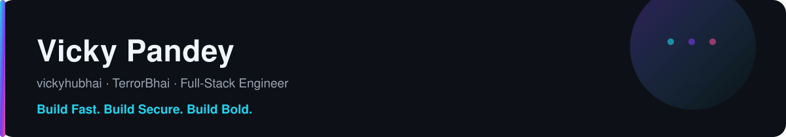

<!--
  Profile README for github.com/vickyhubhai
  · All sections are written as plain Markdown/HTML text, so the profile stays readable
    even when a badge or stats service is temporarily unavailable.
  · Generated asset: the contribution snake below is produced by .github/workflows/snake.yml
    and published to the `output` branch (see "Automation & Setup" at the end).
-->

  

  
  
  
  
  

## About Me

I'm **Vicky Pandey** — a full-stack developer on GitHub as [@vickyhubhai](https://github.com/vickyhubhai), also known as **TerrorBhai**. I build fast, secure web apps, APIs and bots, mostly with **TypeScript** and **Python**, with a consistent focus on authentication, reliability and clean product surfaces.

- **Software development** — building full-stack products end to end: Next.js/React front ends, TypeScript or Python services behind them, and Flutter for mobile.
- **Open source** — my work is public by default ([35+ original repositories](https://github.com/vickyhubhai?tab=repositories&type=source)), with MIT/GPL licensing, issues and discussions open for contributions.
- **AI/ML** — experimenting with LLM-powered apps and API integrations: [ai-api](https://github.com/vickyhubhai/ai-api), [chat-gpt-clone](https://github.com/vickyhubhai/chat-gpt-clone), [nextjs-ai-chatbot](https://github.com/vickyhubhai/nextjs-ai-chatbot).
- **Music technology** — building [Ariya](https://github.com/vickyhubhai/Ariya), a music player and its release/news platform, plus Lavalink-based audio infrastructure for Discord bots ([astrix-lavalink](https://github.com/vickyhubhai/astrix-lavalink)).
- **Security & privacy** — authentication flows, secure API design, privacy policies and safe defaults are recurring themes across my projects.

## Current Projects

| Project | What it is | Stack |
| --- | --- | --- |
| **[Ariya](https://github.com/vickyhubhai/Ariya)** — [live site](https://ariyamusic.us.ci) | Ariya Music Player's production website and release platform: hero/feature showcase, live build picker, release explorer with changelogs and checksums, guides, FAQ and a news feed. | Next.js 16 (App Router) · React 19 · TypeScript · Tailwind CSS v4 |
| **[Ariya_news](https://github.com/vickyhubhai/Ariya_news)** | Release news content consumed by the Ariya site's `/news` section. | Markdown content + `metadata.json` |
| **[AriyaCanary](https://github.com/vickyhubhai/AriyaCanary)** | Automated **canary / nightly builds** for Ariya, published straight from CI (`GPL-3.0`). | GitHub Actions |
| **[astrix-lavalink](https://github.com/vickyhubhai/astrix-lavalink)** | Production-grade **Lavalink manager for Discord bots**: smart node selection, automatic failover, queue recovery, load balancing and health monitoring. | TypeScript |
| **[titanium-bot-dashboard](https://github.com/vickyhubhai/titanium-bot-dashboard)** | Web dashboard for a Discord bot, deployed on Vercel. | TypeScript |
| **[MoviePrice-Watcher](https://github.com/vickyhubhai/MoviePrice-Watcher)** | Ticket-price watcher that tracks multiple Indian booking platforms and emails alerts when prices hit a target. | Node.js · Puppeteer · MongoDB |

Ariya's stack is documented in depth on the [project site](https://ariyamusic.us.ci/developer) and in the [Ariya repository](https://github.com/vickyhubhai/Ariya): the site reads releases live from the GitHub API, caches them in PostgreSQL through Drizzle, validates proxied artwork, and disables heavy 3D/parallax motion for `prefers-reduced-motion`.

## Tech Stack

**Languages**

**Frameworks & runtimes**

**Data & APIs**

**Platforms & tooling**

## GitHub Statistics

  <picture>
    <source media="(prefers-color-scheme: dark)" srcset="https://github-readme-stats.vercel.app/api?username=vickyhubhai&show_icons=true&rank_icon=github&hide_border=true&theme=github_dark">
    <source media="(prefers-color-scheme: light)" srcset="https://github-readme-stats.vercel.app/api?username=vickyhubhai&show_icons=true&rank_icon=github&hide_border=true&theme=default">
    
  </picture>
  <picture>
    <source media="(prefers-color-scheme: dark)" srcset="https://streak-stats.demolab.com?user=vickyhubhai&hide_border=true&theme=github-dark">
    <source media="(prefers-color-scheme: light)" srcset="https://streak-stats.demolab.com?user=vickyhubhai&hide_border=true&theme=default">
    
  </picture>

  <picture>
    <source media="(prefers-color-scheme: dark)" srcset="https://github-readme-stats.vercel.app/api/top-langs/?username=vickyhubhai&layout=compact&langs_count=8&hide_border=true&theme=github_dark">
    <source media="(prefers-color-scheme: light)" srcset="https://github-readme-stats.vercel.app/api/top-langs/?username=vickyhubhai&layout=compact&langs_count=8&hide_border=true&theme=default">
    
  </picture>

  Stats, streak and language figures are computed from my public GitHub data (GitHub REST API) by
  <a href="https://github.com/anuraghazra/github-readme-stats">github-readme-stats</a> and
  <a href="https://github.com/DenverCoder1/github-readme-streak-stats">github-readme-streak-stats</a>.
  The profile-view badge above is a third-party counter, not GitHub data.

## Contribution Activity

  <a href="https://github.com/vickyhubhai/vickyhubhai/tree/output">
    <picture>
      <source media="(prefers-color-scheme: dark)" srcset="https://raw.githubusercontent.com/vickyhubhai/vickyhubhai/output/github-contribution-grid-snake-dark.svg">
      <source media="(prefers-color-scheme: light)" srcset="https://raw.githubusercontent.com/vickyhubhai/vickyhubhai/output/github-contribution-grid-snake.svg">
      
    </picture>
  </a>

  Real contribution graph, automatically regenerated twice a day and on demand by
  <a href="https://github.com/vickyhubhai/vickyhubhai/actions/workflows/snake.yml"><code>snake.yml</code></a>
  (<a href="https://github.com/Platane/snk">Platane/snk</a>); assets live on the
  <a href="https://github.com/vickyhubhai/vickyhubhai/tree/output"><code>output</code></a> branch.

## Featured Projects

<table align="center">
  <tr>
    <td width="50%" align="center">
      <a href="https://github.com/vickyhubhai/Ariya">
        <picture>
          <source media="(prefers-color-scheme: dark)" srcset="https://github-readme-stats.vercel.app/api/pin/?username=vickyhubhai&repo=Ariya&hide_border=true&theme=github_dark">
          <source media="(prefers-color-scheme: light)" srcset="https://github-readme-stats.vercel.app/api/pin/?username=vickyhubhai&repo=Ariya&hide_border=true&theme=default">
          
        </picture>
      </a>
       
      Ariya Music Player — website &amp; release platform · <a href="https://ariyamusic.us.ci">ariyamusic.us.ci</a>
    </td>
    <td width="50%" align="center">
      <a href="https://github.com/vickyhubhai/astrix-lavalink">
        <picture>
          <source media="(prefers-color-scheme: dark)" srcset="https://github-readme-stats.vercel.app/api/pin/?username=vickyhubhai&repo=astrix-lavalink&hide_border=true&theme=github_dark">
          <source media="(prefers-color-scheme: light)" srcset="https://github-readme-stats.vercel.app/api/pin/?username=vickyhubhai&repo=astrix-lavalink&hide_border=true&theme=default">
          
        </picture>
      </a>
       
      Lavalink node manager for Discord bots with failover &amp; queue recovery
    </td>
  </tr>
  <tr>
    <td width="50%" align="center">
      <a href="https://github.com/vickyhubhai/MoviePrice-Watcher">
        <picture>
          <source media="(prefers-color-scheme: dark)" srcset="https://github-readme-stats.vercel.app/api/pin/?username=vickyhubhai&repo=MoviePrice-Watcher&hide_border=true&theme=github_dark">
          <source media="(prefers-color-scheme: light)" srcset="https://github-readme-stats.vercel.app/api/pin/?username=vickyhubhai&repo=MoviePrice-Watcher&hide_border=true&theme=default">
          
        </picture>
      </a>
       
      Ticket price tracker with email alerts · Node.js, Puppeteer, MongoDB
    </td>
    <td width="50%" align="center">
      <a href="https://github.com/vickyhubhai/titanium-bot-dashboard">
        <picture>
          <source media="(prefers-color-scheme: dark)" srcset="https://github-readme-stats.vercel.app/api/pin/?username=vickyhubhai&repo=titanium-bot-dashboard&hide_border=true&theme=github_dark">
          <source media="(prefers-color-scheme: light)" srcset="https://github-readme-stats.vercel.app/api/pin/?username=vickyhubhai&repo=titanium-bot-dashboard&hide_border=true&theme=default">
          
        </picture>
      </a>
       
      Discord bot dashboard for the web · TypeScript, deployed on Vercel
    </td>
  </tr>
</table>

## Connect With Me

- **GitHub** — [github.com/vickyhubhai](https://github.com/vickyhubhai) · [all repositories](https://github.com/vickyhubhai?tab=repositories) · [Ariya discussions](https://github.com/vickyhubhai/Ariya/discussions)
- **Website** — [ariyamusic.us.ci](https://ariyamusic.us.ci) (Ariya Music Player)
- **Email** — [pandeyvicky185@gmail.com](mailto:pandeyvicky185@gmail.com)

I'm currently open to opportunities — the fastest way to reach me is email.

## Automation & Setup

Everything on this profile is either plain Markdown or a read-only public service, so nothing here needs secrets.

- **Contribution snake (automated).** [`.github/workflows/snake.yml`](.github/workflows/snake.yml) regenerates light and dark snake SVGs on a 12-hour schedule, on manual trigger (Actions → *Generate Contribution Snake* → *Run workflow*), and whenever the workflow file itself changes. It publishes them to the [`output`](https://github.com/vickyhubhai/vickyhubhai/tree/output) branch, which is where this README loads them from. The workflow uses the built-in `GITHUB_TOKEN` with `contents: write` and no other permissions or secrets; the branch is created automatically on first run.
- **Self-hosted banner.** `assets/banner.svg` ships in this repository, so the header cannot break when a third-party service is down. It adapts to light/dark mode via `prefers-color-scheme`.
- **Third-party widgets (may be rate-limited).** Stats, streak and language cards come from *github-readme-stats* and *github-readme-streak-stats*; badges from *shields.io*; the profile-view counter from *komarev.com*. These are decorative/derived readings of my public GitHub data — the view counter in particular is a third-party estimate, not GitHub data. If a public instance is rate-limited or unavailable, that single image may fail to load while the rest of the page still renders.
- **Refreshing.** To refresh widget numbers, re-run the snake workflow or push a README edit; image caching (browser and GitHub's image proxy) can delay changes by a few minutes.
- **Local validation (optional).** `python scripts/validate_profile.py` checks the workflow YAML, README structure, local asset paths and secret patterns; `python scripts/check_links.py` resolves every external URL in the README. Both need Python 3 with PyYAML.
